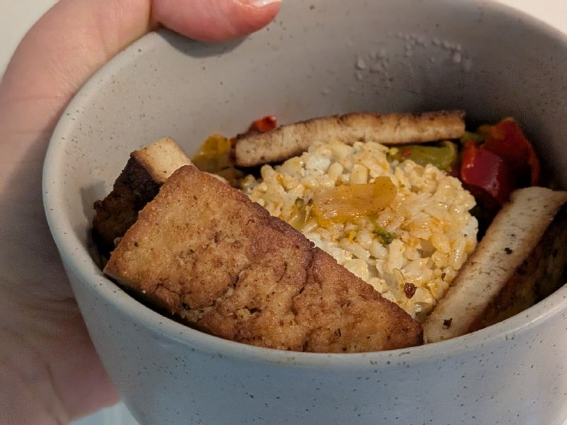

Tofu gets a bad rap. It's tasty, you just have to treat it right.

I'm gonna teach you my amazing secret to enjoy a tasty tofu treat.

> A picture of a bowl of rice with peppers, onions, broccoli, and fried tofu set around it

This doesn't involve pressing your tofu dry, but still has a couple of hours (at least) of lead time.

## You'll Need

* Extra Firm Tofu (higher protein tofu makes for a better final texture)
* Soy Sauce
* Crushed Red Pepper
* (Optional) Additional Sauces
* Neutral Oil with a high smoke point (Vegetable/Canola works)
* A shallow pan of some sort
* A stovetop

## Steps

1) Cut your tofu into thin slices, I prefer about 5mm thick. 
Only the smallest dimension matters  very much, so feel free to play around with it.
I try to stick to something bite-sized.
2) Mix soy sauce, Crushed Red Pepper, and any bonus sauces or spices into a gallon-sized back or flat container.
Don't use any dry granulated spices, as they may burn when fried.
3) Put your tofu slices in the bag or container, squeezing out all the air you can.
4) Leave for at least 2 hours, up to 48.
5) When ready to prepare, thoroughly coat the bottom of a shallow frying pan in your neutral oil, then heat over medium-high heat until shimmering.
6) Fry the tofu in the oil for ~2-3 minutes, flipping once it starts to brown then cooking for about a minute less than the first side.
You don't need to worry about agitating it too much here, it'll be fine whether you're flipping it constantly or leave it to sit, though it'll cook faster if you leave it.
7) Extract onto a paper towel, wait a few minutes to cool, and enjoy!
These reheat well, so I often put them on rice bowls for my meal prep (pictured above).

## Conclusion

mmmmmmmmmmmmmmmmmm